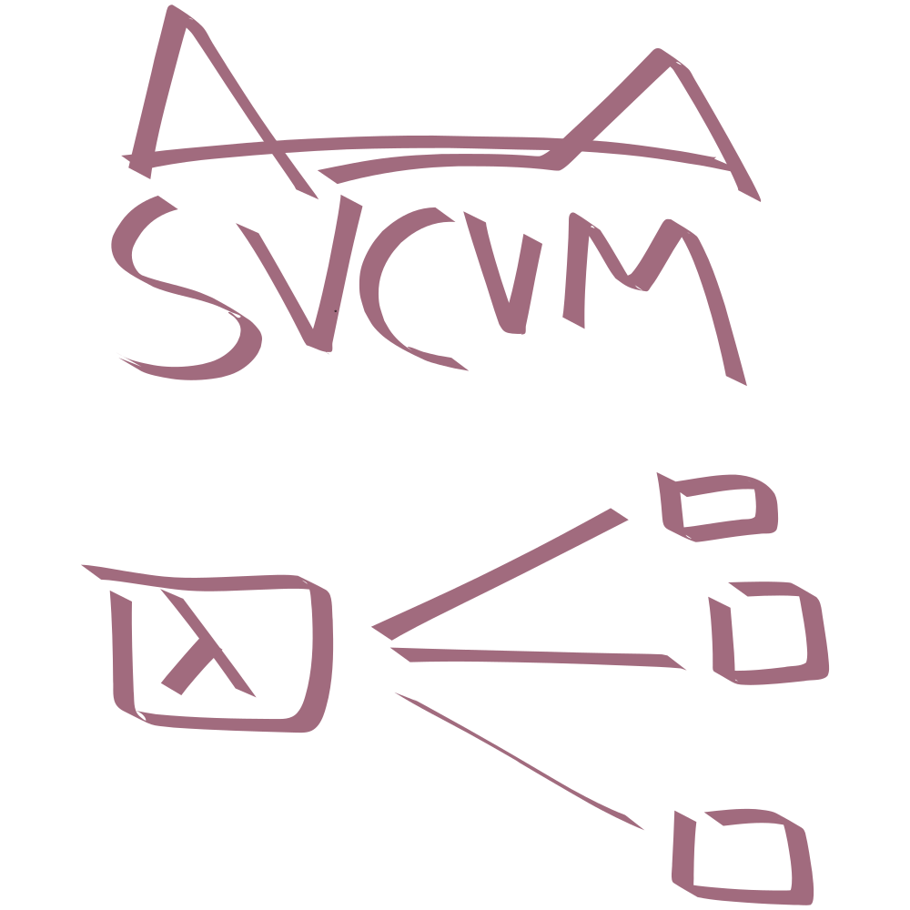
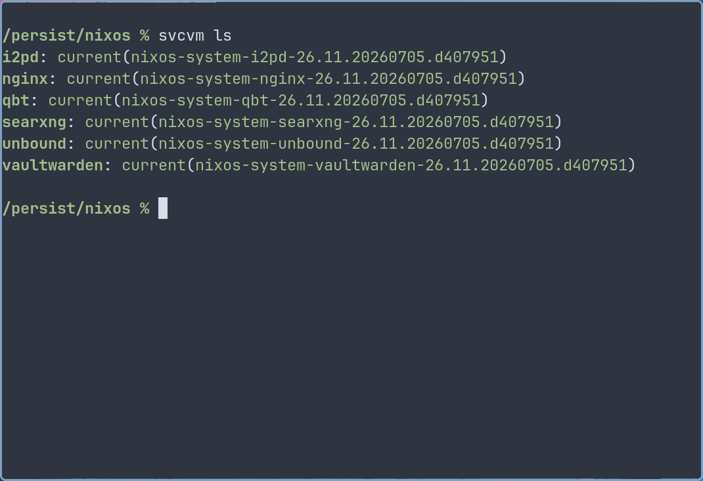

# svcvm

service virtual machines for NixOS, derived from
[microvm.nix](https://github.com/microvm-nix/microvm.nix).

# Notice

svcvm is a deliberately minimal derivative of
[microvm.nix](https://github.com/microvm-nix/microvm.nix). It removes features
that are unnecessary for my deployment model.

svcvm contains substantial portions of code derived from the microvm.nix
project. A copy of the original MIT license is available in
[`LICENSES/MIT-microvm-nix`](./LICENSES/MIT-microvm-nix). Additional changes
introduced here are licensed under [GPLv3](./LICENSE).

# Features

- create QEMU/KVM virtual machines using the `microvm` machine type
- manage these using the `svcvm` CLI or the various `svcvm@` systemd units
- VMs have the host's Nix Store as a `virtiofs` readonly share, and a `tmpfs`
  root
- share additional filesystems from the host using `virtiofs` (eg, for
  persistent service data)
- share secrets and credentials (eg, sops-nix secrets) from the host using
  `io.systemd.credentials`
- create vhost-enabled TAP interfaces for routed networking to be used along
  with NAT (eg, using nftables)

The following features are intentionally unsupported (non-exhaustive list):

- no standalone usage, only available as a NixOS module
- no 9p shares, only virtiofs shares
- no separate Nix Store, host's Store is always shared
- no writable Nix Store, no Nix within svcvm guests
- no bridge and macvtap interfaces, only vhost-enabled TAP
- no graphics, all svcvm guests use `-nographic`
- no hypervisors other than QEMU, KVM is always used
- no platforms other than `x86_64-linux`
- no QEMU machines other than `microvm`

# Usage

> Consider using [microvm.nix](https://github.com/microvm-nix/microvm.nix)
> instead, since it is much more generic and intended for a wider range of use
> cases.

> This flake is written only for my personal use. The only configuration that
> matters is the one I actually use in my
> [NixOS configuration](https://github.com/sotormd/nixos), using the downstream
> `lib.mksvcvm` layer which provides declarative provisioning, `svcready`
> readiness indicators and `svcfg` service configuration.

> Usage instructions are deliberately omitted.
